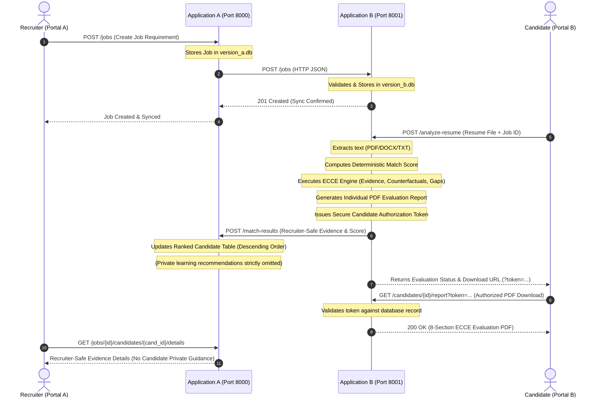

# JobMatchHire – Intelligent Resume and Job Matching Platform with ECCE

**JobMatchHire** is an enterprise-grade distributed resume and job requirement matching platform built with **Python**, **FastAPI**, and the **ECCE** (Explainable Contextual Competency Engine with Automated Counterfactual Gap Remediation). It features a strictly decoupled, two-application microservice architecture where recruitment job management and candidate resume parsing/evaluation are executed independently across separate services with separate SQLite databases and dedicated frontends.

---

## Architecture Overview

```text
JobMatchHire/
├── version_a/                      # Application A: Recruiter Portal (Port 8000)
│   ├── database.py                 # SQLite database layer (version_a.db)
│   ├── main.py                     # FastAPI backend & recruiter API routing
│   ├── requirements.txt            # Python dependencies for Application A
│   ├── schemas.py                  # Pydantic request & response models
│   ├── version_a.db                # SQLite database (auto-created on startup)
│   └── static/                     # Recruiter Portal Frontend
│       ├── index.html              # Modern Recruiter Dashboard with Inspection Modal
│       ├── style.css               # Clean professional styling
│       └── app.js                  # Frontend state, ranked candidate tables & modals
│
├── version_b/                      # Application B: Candidate Matching & Evaluation (Port 8001)
│   ├── database.py                 # SQLite database layer (version_b.db) with versioning & tokens
│   ├── ecce_engine.py              # ECCE Engine: Contextual competency & counterfactuals
│   ├── report_generator.py         # ReportLab PDF Generator (8-section official evaluation report)
│   ├── reports/                    # Generated PDF reports storage
│   ├── extractor.py                # Text extraction (PDF, DOCX, TXT), skills & experience
│   ├── main.py                     # FastAPI backend & authorized download endpoints
│   ├── matcher.py                  # Deterministic baseline scoring model
│   ├── requirements.txt            # Python dependencies for Application B
│   ├── schemas.py                  # Pydantic models for jobs & candidate evaluations
│   ├── skills_dict.py              # Skill taxonomy & canonical aliases
│   ├── version_b.db                # SQLite database (auto-created on startup)
│   └── static/                     # Candidate Portal Frontend
│       ├── index.html              # Clean candidate submission & status interface
│       ├── style.css               # Candidate matching portal styling
│       └── app.js                  # Upload handler, evaluation status & report download
│
├── sample_resumes/                 # Sample test resumes (.pdf, .docx, .txt)
├── reset_db.py                     # 1-click clean database reset before faculty demos
└── verify_workflow.py              # Complete end-to-end integration and security test suite
```

---

## Inter-Service Workflow and Privacy Boundaries



---

## Quick Start & Verification

### 1. Launch Application A (Recruiter Portal - Port 8000)
```powershell
cd "MatchHire\version_a"
python -m uvicorn main:app --host 127.0.0.1 --port 8000 --reload
```
Portal A URL: `http://127.0.0.1:8000`

### 2. Launch Application B (Candidate Matching Portal - Port 8001)
```powershell
cd "MatchHire\version_b"
python -m uvicorn main:app --host 127.0.0.1 --port 8001 --reload
```
Portal B URL: `http://127.0.0.1:8001`

### 3. Run Complete End-to-End Test Suite
```powershell
cd "MatchHire"
python verify_workflow.py
```
All 8 verification steps (health checks, job dispatch, ECCE evaluation, token authorization, PDF generation, candidate re-evaluation, leaderboard ranking, and recruiter inspection privacy assertion) will execute automatically.

